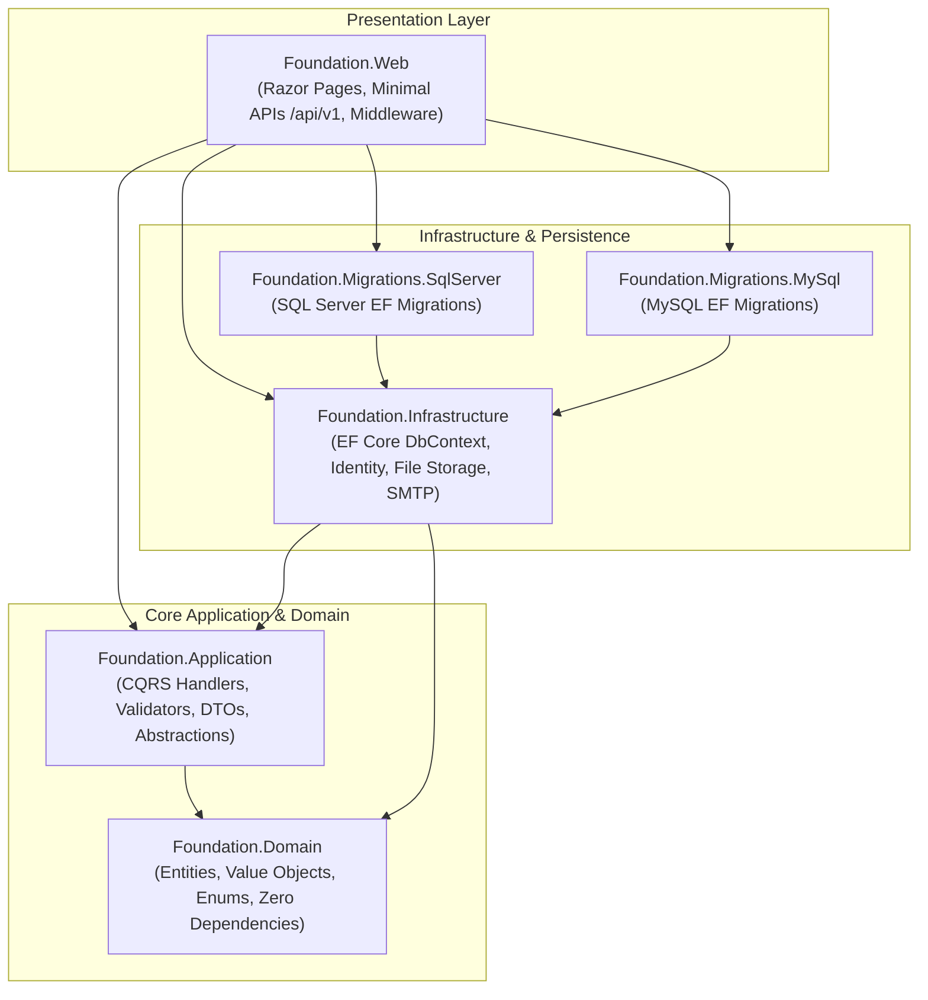

# dotnet-web-foundation

[](https://github.com/thesanketkale/dotnet-webapp-template/actions/workflows/ci.yml)
[](https://github.com/thesanketkale/dotnet-webapp-template/actions/workflows/codeql.yml)
[](https://github.com/thesanketkale/dotnet-webapp-template/actions/workflows/dependency-review.yml)
[](https://opensource.org/licenses/MIT)
[](https://dotnet.microsoft.com/)

A modular, production-ready ASP.NET Core web application foundation with ASP.NET Core Identity, multi-factor authentication (TOTP 2FA), user profiles, an admin dashboard with a secure Markdown CMS, dual-provider EF Core persistence on SQL Server or MySQL, OpenTelemetry observability, and a hardened container image.

---

## 1. Purpose & Target Audience

`dotnet-web-foundation` is engineered for software engineers, startups, and enterprise teams seeking an uncompromised, clean-architecture starter for SaaS platforms, internal business portals, and RESTful web services. Built from a strict clean room with zero commercial dependencies, it removes boilerplate friction while establishing rigorous security, compliance, and maintainability standards on day one.

---

## 2. Verification Status

The table below honestly distinguishes **CI-proven checks** executed automatically in pipeline runners from **Owner-verified items** requiring host Docker daemons or external cloud infrastructure.

| Verification Area | Verification Scope | Status | Evidence / Notes |
| :--- | :--- | :--- | :--- |
| **Solution Compilation** | CI-Proven | `PASSING` | Clean compilation across all 10 projects with .NET 10 LTS (`net10.0`). |
| **Unit Tests** | CI-Proven | `PASSING` | 13 tests passing (Domain entities, Markdig XSS sanitization, storage isolation). |
| **Architecture Tests** | CI-Proven | `PASSING` | 4 NetArchTest boundary rules passing (Domain/Application layer independence). |
| **Integration Tests** | CI-Proven | `PASSING` | 6 tests passing (Auth token endpoint, lockout at 5 attempts, CSP headers, health). |
| **E2E Smoke Tests** | CI-Proven | `PASSING` | 2 tests passing (OpenAPI 3.1 specification schema, config integrity). |
| **License Compliance** | CI-Proven | `PASSING` | `pwsh scripts/check-licenses.ps1` verifies 29 approved packages (MIT/Apache-2.0/BSD). |
| **CI Workflow Lint** | CI-Proven | `PASSING` | `actionlint` passes with zero warnings; all third-party actions pinned to commit SHAs. |
| **Docker Compose Stack** | Owner-Verified | `READY` | Requires host Docker daemon (`docker compose --profile sqlserver up -d`). |
| **Playwright Browser Tests**| Owner-Verified | `READY` | Requires local browser driver installation (`playwright.ps1 install`). |
| **Production Cloud Deploy** | Owner-Verified | `READY` | Requires active cloud subscription with OIDC provider federation. |

---

## 3. Architecture Overview

The solution adheres strictly to Clean Architecture and vertical-slice use case boundaries:



For complete architectural details and C4 models, see [docs/architecture.md](docs/architecture.md).

---

## 4. Key Features

- **Enterprise Identity & Auth:** ASP.NET Core Identity with password policies (min 12 chars), automatic lockout after 5 consecutive failed attempts, email verification, TOTP 2FA (RFC 6238) with Google/Microsoft Authenticator, and 10 single-use recovery codes.
- **GDPR Compliance Built-In:** Machine-readable personal data export (JSON) and self-service account deletion (right to erasure) with password confirmation.
- **Lightweight Markdown CMS:** Admin CMS with GitHub Flavored Markdown (Markdig) sanitized against XSS vectors via `HtmlSanitizer`. Automatic revision history and field-level mutation audit logging via EF Core interceptors.
- **Dual Database Provider Support:** Dedicated migration assemblies for Microsoft SQL Server (`Foundation.Migrations.SqlServer`) and MySQL / MariaDB (`Foundation.Migrations.MySql`).
- **Comprehensive Defense-in-Depth:** Content Security Policy (CSP) with dynamic cryptographic nonces, `X-Frame-Options: DENY`, `X-Content-Type-Options: nosniff`, anti-forgery tokens on every POST request, and IDOR validation in use cases.
- **Observability:** Serilog structured logging, OpenTelemetry tracing and metrics instrumentation with OTLP export, and container health endpoints (`/health/live`, `/health/ready`).
- **Zero Commercial Dependencies:** Strict policy banning MediatR v12+, AutoMapper, or FluentAssertions v8+ in favor of clean first-party C# abstractions and MIT-licensed test utilities (`Shouldly`).

---

## 5. Quickstart (Under 5 Commands)

Get the application running locally with SQLite/In-Memory or disposable SQL Server containers:

```bash
# 1. Clone repository
git clone https://github.com/thesanketkale/dotnet-webapp-template.git
cd dotnet-webapp-template

# 2. Restore dependencies
dotnet restore

# 3. Run all automated tests
dotnet test

# 4. Launch the application locally (defaults to http://localhost:5000)
dotnet run --project src/Foundation.Web
```

*(Optional: Launch background SQL Server and Mailpit services with `docker compose --profile sqlserver up -d`)*

---

## 6. Configuration Reference

The application can be configured via `appsettings.json`, environment-specific overrides (`appsettings.Development.json`), or environment variables:

| Setting Key | Environment Variable | Default | Description |
| :--- | :--- | :--- | :--- |
| `Database:Provider` | `Database__Provider` | `SqlServer` | Database provider (`SqlServer` or `MySql`). |
| `Database:ApplyMigrationsAtStartup` | `Database__ApplyMigrationsAtStartup` | `true` | Automatically applies pending EF migrations and seeds data. |
| `ConnectionStrings:DefaultConnection` | `ConnectionStrings__DefaultConnection` | Local SQL Server | SQL Server connection string. |
| `ConnectionStrings:MySqlConnection` | `ConnectionStrings__MySqlConnection` | Local MySQL | MySQL connection string. |
| `Storage:LocalStoragePath` | `Storage__LocalStoragePath` | `App_Data/uploads` | Path to store user avatars and CMS media. |
| `Email:Host` | `Email__Host` | `localhost` | SMTP host (default targets Mailpit on port 1025). |
| `OpenTelemetry:OtlpEndpoint` | `OpenTelemetry__OtlpEndpoint` | `http://localhost:4317` | OpenTelemetry OTLP collector endpoint. |

For detailed options, refer to [docs/configuration.md](docs/configuration.md).

---

## 7. Development & Verification

### Running the Verification Suite
Before committing code, run the repository verification script:

```powershell
# Windows PowerShell
./scripts/verify.ps1 full

# Linux / macOS Bash
./scripts/verify.sh full
```

### Fast Check (Build & Unit Tests Only)
```powershell
./scripts/verify.ps1 fast
```

### License Audit
```powershell
pwsh scripts/check-licenses.ps1
```

---

## 8. Security & Hardening

- **Hardened Container Image:** Multi-stage `Dockerfile` utilizing Ubuntu Noble Chiseled non-root base images (`mcr.microsoft.com/dotnet/aspnet:10.0-noble-chiseled`), dropping root privileges to `$APP_UID` (1654).
- **Least-Privilege GitHub Actions:** All workflows declare minimal top-level permissions (`permissions: contents: read`), pin third-party actions to full 40-character commit SHAs, and execute automated `gitleaks` and `dependency-review` security scans.
- **Reporting Vulnerabilities:** Please see [SECURITY.md](SECURITY.md) for vulnerability disclosure protocols.

---

## 9. Documentation Directory

- [docs/architecture.md](docs/architecture.md): C4 architecture model, layer boundaries, and Mermaid diagrams.
- [docs/authentication.md](docs/authentication.md): ASP.NET Core Identity, TOTP 2FA, lockout, and GDPR data portability.
- [docs/database-providers.md](docs/database-providers.md): SQL Server & MySQL migration guidelines.
- [docs/cms.md](docs/cms.md): Markdown parsing, sanitization, media streaming, and audit trail interceptor.
- [docs/configuration.md](docs/configuration.md): Complete configuration settings reference.
- [docs/observability.md](docs/observability.md): Serilog, OpenTelemetry tracing, and health checks.
- [docs/testing.md](docs/testing.md): Unit, integration, architecture, and E2E testing strategies.
- [docs/verification-log.md](docs/verification-log.md): Verifiable execution log for CI and owner validation.

---

## 10. License & Attribution

Distributed under the **MIT License**. See [LICENSE](LICENSE) and [NOTICE](NOTICE) for complete copyright terms.

Copyright (c) 2026 Sanket Kale.

---

## 11. Related Projects

This repository is part of a cohesive open-source engineering suite maintained by [thesanketkale](https://github.com/thesanketkale):

| Repository | Description | Technology Stack |
| :--- | :--- | :--- |
| [reusable-workflows](https://github.com/thesanketkale/reusable-workflows) | Enterprise GitHub Actions reusable workflows and security baseline. | GitHub Actions, Shell, YAML |
| [php-api-foundation](https://github.com/thesanketkale/php-api-foundation) | Production-ready PHP 8.4 REST API skeleton with clean architecture. | PHP 8.4, Slim, PDO, MySQL |
| [electron-foundation](https://github.com/thesanketkale/electron-foundation) | Secure Electron desktop application with auto-update and code signing. | Electron, TypeScript, React |
| [unity-openxr-foundation](https://github.com/thesanketkale/unity-openxr-foundation) | Cross-platform Unity XR template for Meta Quest and Apple Vision Pro. | Unity 6 LTS, C#, OpenXR, XRI |
| **dotnet-web-foundation** | *(This repository)* Modular ASP.NET Core web foundation with Identity & CMS. | .NET 10 LTS, ASP.NET Core, EF Core |
| [terragrunt-baseline](https://github.com/thesanketkale/terragrunt-baseline) | Multi-account AWS infrastructure baseline with Terragrunt & OpenTofu. | Terragrunt, OpenTofu, AWS |
| [unity-build-pipeline](https://github.com/thesanketkale/unity-build-pipeline) | Self-hosted cross-platform CI/CD build runner for Unity projects. | GitHub Actions, PowerShell, Docker |
| [unity-ui-context](https://github.com/thesanketkale/unity-ui-context) | Runtime inspection and context bridge for AI agents driving Unity UI. | C#, Unity UIElements, JSON-RPC |
| [job-desk](https://github.com/thesanketkale/job-desk) | Local-first desktop career application tracker with privacy-first storage. | Electron, React, SQLite |
