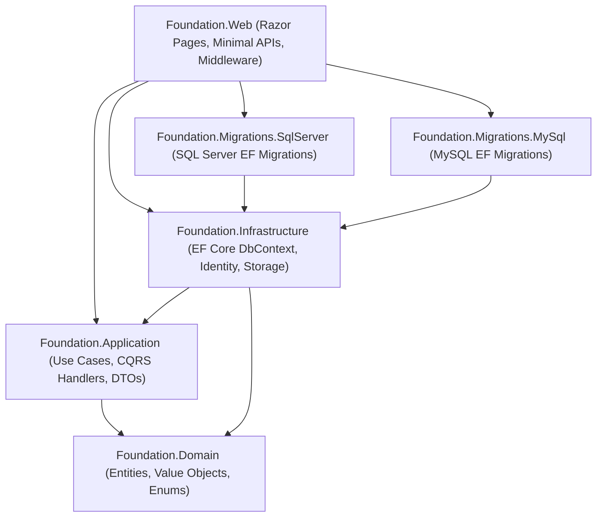
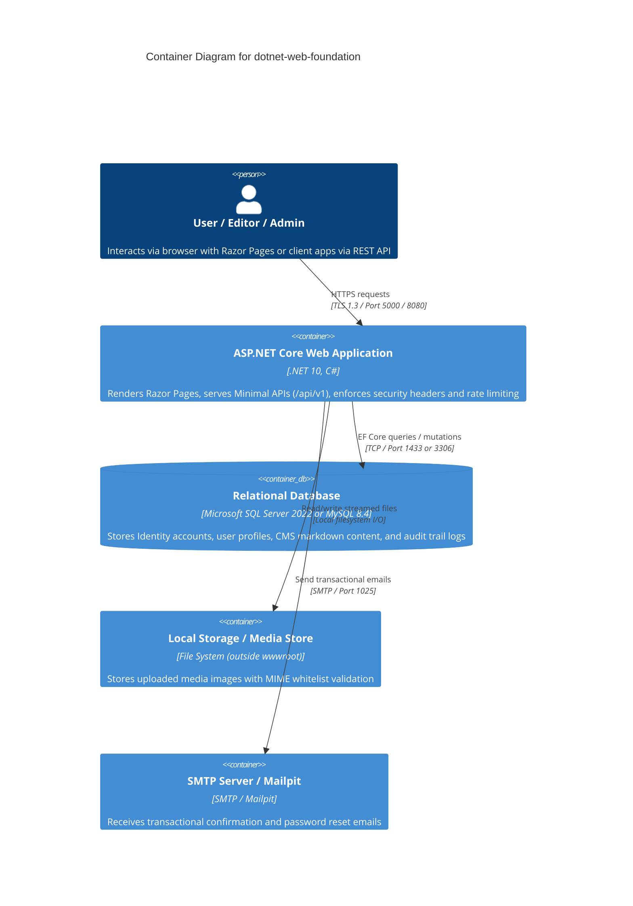

# Architecture & Design

`dotnet-web-foundation` is architected as a modular, clean-architecture ASP.NET Core foundation designed for enterprise web applications, internal tools, and SaaS starters.

---

## 1. Solution Structure & Layer Boundaries

The repository strictly enforces dependency direction: outer layers depend inward toward domain entities, while the domain layer maintains zero dependencies on external frameworks or databases.

### Layer Responsibilities

| Project | Responsibility | Dependencies |
| :--- | :--- | :--- |
| `Foundation.Domain` | Core entities (`UserProfile`, `CmsPage`, `CmsPost`, `MediaFile`, `AuditEntry`), business rules, and enums. | None (pure .NET standard library). |
| `Foundation.Application` | CQRS use cases, validation, DTOs, domain service abstractions (`IAppDbContext`, `ICurrentUser`, `IFileStorageService`, `IMarkdownRenderer`). | `Foundation.Domain`. |
| `Foundation.Infrastructure` | EF Core `AppDbContext`, Identity stores, audit interceptors, local disk storage, SMTP email delivery, Markdig markdown pipeline. | `Foundation.Application`, `Foundation.Domain`, EF Core, ASP.NET Core Identity. |
| `Foundation.Migrations.SqlServer` | Dedicated Entity Framework Core migrations for Microsoft SQL Server. | `Foundation.Infrastructure`. |
| `Foundation.Migrations.MySql` | Dedicated Entity Framework Core migrations for MySQL / MariaDB. | `Foundation.Infrastructure`. |
| `Foundation.Web` | Razor Pages (UI, Admin, Account management), Minimal APIs (`/api/v1`), security middleware, OpenTelemetry, Serilog. | All source projects. |

---

## 2. C4 Container Diagram

---

## 3. Key Architectural Decisions

1. **Clean-Room & Zero Commercial Dependencies:** Zero commercial packages or restrictive licenses. No MediatR v12+, AutoMapper, or FluentAssertions v8+. CQRS handlers use clean first-party generic interfaces `ICommandHandler<TCommand, TResult>` and `IQueryHandler<TQuery, TResult>`.
2. **Provider-Agnostic Relational Migrations:** Separate migration assemblies allow seamless deployment to Microsoft SQL Server on Azure/AWS or MySQL on RDS/containers without dirty snapshot collisions.
3. **Hardened Defense-in-Depth:**
   - Content Security Policy (CSP) with dynamically generated cryptographic nonces per HTTP request.
   - Soft delete query filters and automatic JSON field-level mutation audit logs via EF Core interceptors.
   - IDOR prevention in every CQRS handler verifying caller authorization against `ICurrentUser`.
